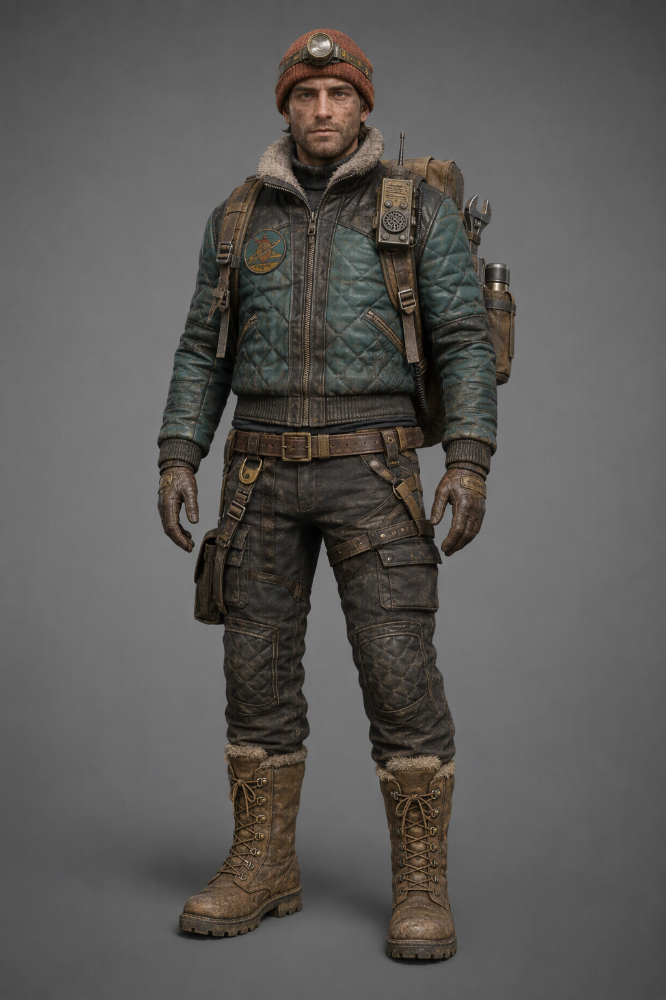

# Болтик — десктоп-питомец в духе ARC Raiders



**Болтик** — маленький зимний рейдер-механик для рабочего стола Kimi Work, вдохновлённый стилистикой [ARC Raiders](https://arcraiders.com/) (Embark Studios): ретро-футуризм 70-х, потёртая стёганая куртка, рыжая шапка с налобным фонарём, рюкзак с гаечным ключом, термосом и рацией.

> Фанатский проект, не аффилирован с Embark Studios. ARC Raiders и все связанные материалы — торговые марки Embark Studios и её лицензиаров.

## Возможности

- **9 анимационных состояний** (спрайтшит 2048×2592, кадры 256×288):
  - `idle` — спокойное ожидание (8 кадров)
  - `running_left` / `running_right` — бег при перетаскивании (по 8 кадров)
  - `working` — ковыряется с деталью, пока идёт задача (7 кадров)
  - `waiting` — постукивает по экрану, когда нужно подтверждение (8 кадров)
  - `failed` — падает и поднимается (8 кадров)
  - `idle_random_1` — достаёт термос и греется (8 кадров)
  - `idle_random_2` — вертит гаечный ключ (7 кадров)
  - `celebration` — **«пиу-пиу-пиу!»**: достаёт самодельный бластер и радостно палит вверх при завершении задачи (6 кадров)
- **Празднование завершения задачи**: отслеживает переход диалога `running → idle` через `window.DaimonWidget.conversations.status` и проигрывает `celebration` с фразой в облачке.
- **Случайные шутки**: каждые 3–8 минут в режиме покоя выдаёт реплику (русская и английская локали, по языку хоста).
- **Реакция на клик**: отвечает фразой на клик (перетаскивание не затрагивается — арбитраж на стороне хоста).
- **Лог хода задачи**: встроенный пузырь показывает активные задачи, текущий шаг («Вызов инструмента…»), статусы и быстрые ответы.
- **Тема облачка** выведена из палитры персонажа: `#4A4038` фон, `#FFFFFF` текст, `#726A64` рамка.

## Структура

```
├── pet.json              # манифест питомца (состояния, кадры, fps, тема)
├── spritesheet.png       # атлас анимаций 2048×2592, 8 колонок × 9 рядов
├── runtime-index.html    # кастомизированный рантайм виджета (празднование, шутки, клики)
├── assets/
│   ├── character-reference.png  # утверждённый референс персонажа
│   ├── atlas-preview.jpg        # превью атласа
│   └── board-*.png              # исходные сгенерированные доски анимаций
├── LICENSE               # MIT
└── README.md
```

## Установка

Пакет (`pet.json` + `spritesheet.png`) устанавливается как Pet-виджет Kimi Work:

```json
{ "action": "installPet", "packagePath": "pets/boltik" }
```

После установки питомец включается в **Настройки → Десктоп-питомец**. Чтобы получить кастомное поведение (празднование, шутки, реплики по клику), скопируйте `runtime-index.html` поверх `index.html` в рабочей папке установленного виджета — переустановка пакета пользовательский `index.html` не затирает.

## Кастомизация

Все поведенческие настройки живут в блоке «Кастомизация Болтика» внутри `runtime-index.html`:

| Константа | Назначение | По умолчанию |
|---|---|---|
| `QUIP_MIN_DELAY_MS` / `QUIP_MAX_DELAY_MS` | Интервал случайных шуток | 3–8 минут |
| `BOLTIK_QUIPS.ru / .en` | Фразы: `celebration`, `idle`, `click` | см. код |
| `celebration.fps` | Скорость «пиу-пиу» | 10 |

Новые состояния добавляются в атлас сборщиком `build_image_generation_pet.py` (режим `--add-state`), затем состояние подключается к событию в рантайме.

## Как это сделано

1. Референс персонажа сгенерирован в стиле официального арта ARC Raiders и утверждён вручную.
2. Три доски 2K 16:9 на хромакее `#FF00FF`: базовые действия, взаимодействия, кастомное `celebration`.
3. Сборка пакета: хромакей-удаление, извлечение поз connected-components, нормализация в кадры 256×288.
4. Кастомизация рантайма: детектор завершения задач, планировщик шуток, обработчик кликов.

## Лицензия

Код и пайплайн — [MIT](LICENSE). Персонаж является оригинальной фанатской работой, вдохновлённой ARC Raiders; не используйте его коммерчески.
